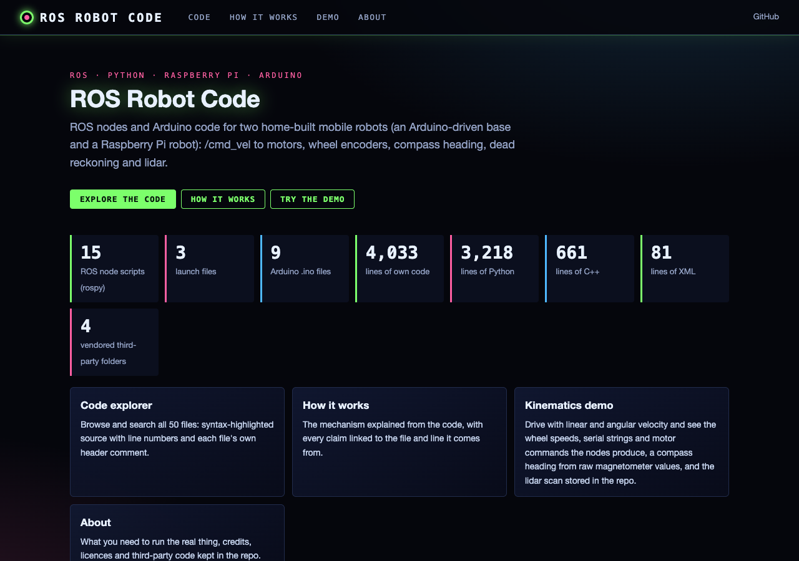
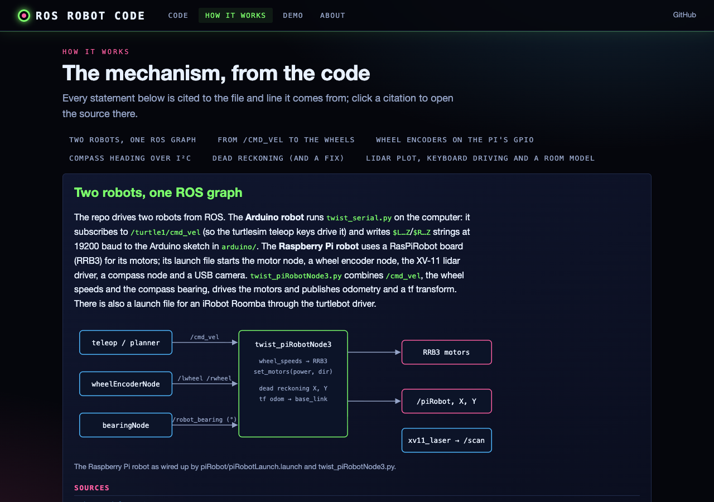
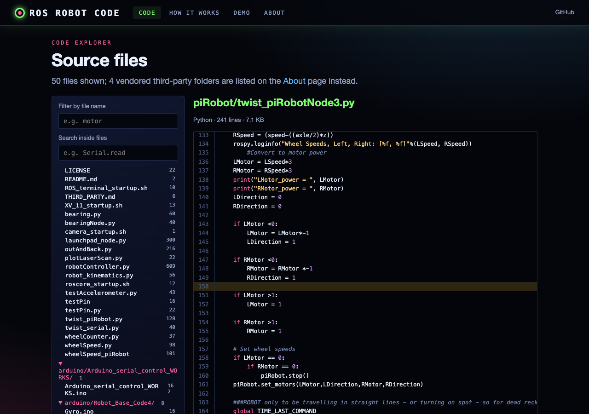
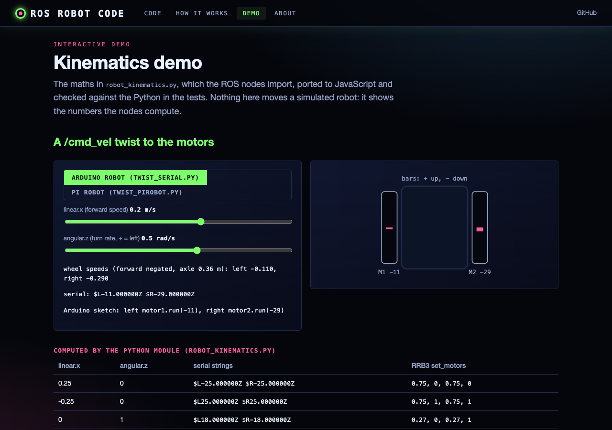

# robot_code
Code to control arduino/raspberry pi robot

ROS nodes (Python 2 era) and Arduino sketches for two home-built robots: an Arduino/Makeblock base driven over serial
(`twist_serial.py` -> `arduino/`) and a Raspberry Pi robot on a RasPiRobot v3 board (`twist_piRobot.py`,
`piRobot/`: wheel encoders, compass, dead reckoning, XV-11 lidar, camera), plus launch files for the Pi robot and a
Roomba. `robot_kinematics.py` holds the pure maths the nodes import (copy it next to the scripts when deploying).
Third-party files are listed in `THIRD_PARTY.md`.

## Web interface

A showcase site: code explorer (highlighted source, search, each file's own header comment), "How it works" with
every statement linked to the file and line it comes from, About (third-party files with their licences), and a
**kinematics demo**: `robot_kinematics.py` ported to JavaScript (checked against the Python in the tests) turning a
`/cmd_vel` twist into the serial strings or RRB3 motor commands, a compass heading from raw magnetometer values, and
the lidar scan recorded in `plotLaserScan.py`.

`pip install -r requirements-web.txt && python run_web.py` (http://127.0.0.1:8259). `python scripts/build_static.py`
builds the GitHub Pages copy (`.github/workflows/pages.yml`, on push to `master`).

| Home | How it works | Source viewer | Kinematics demo |
|---|---|---|---|
|  |  |  |  |

Tests: `python -m pytest -q tests` (web API and static build, robot_kinematics vs the original callbacks, dead-reckoning
regression tests with stand-in ROS modules, the Arduino sketch compiled on the desktop; needs a C++ compiler) and
`node web/static/kinematics_engine.test.mjs`.
